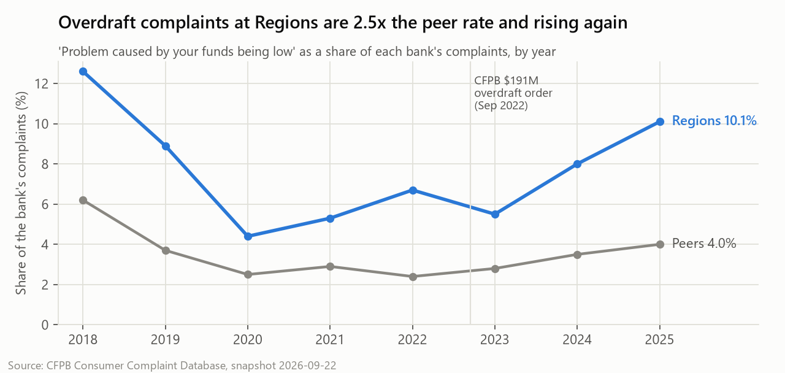
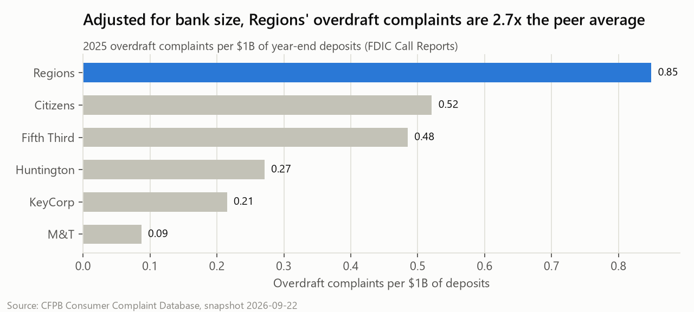
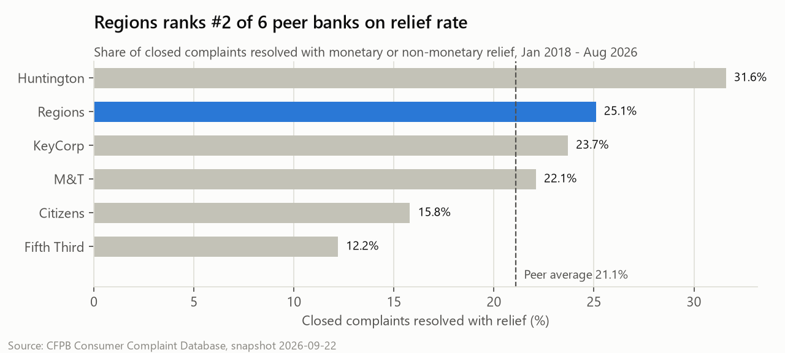
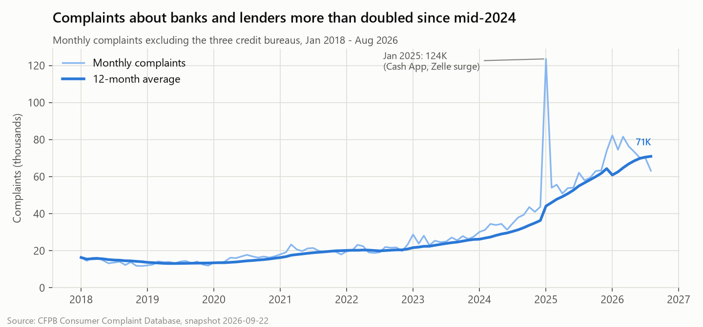
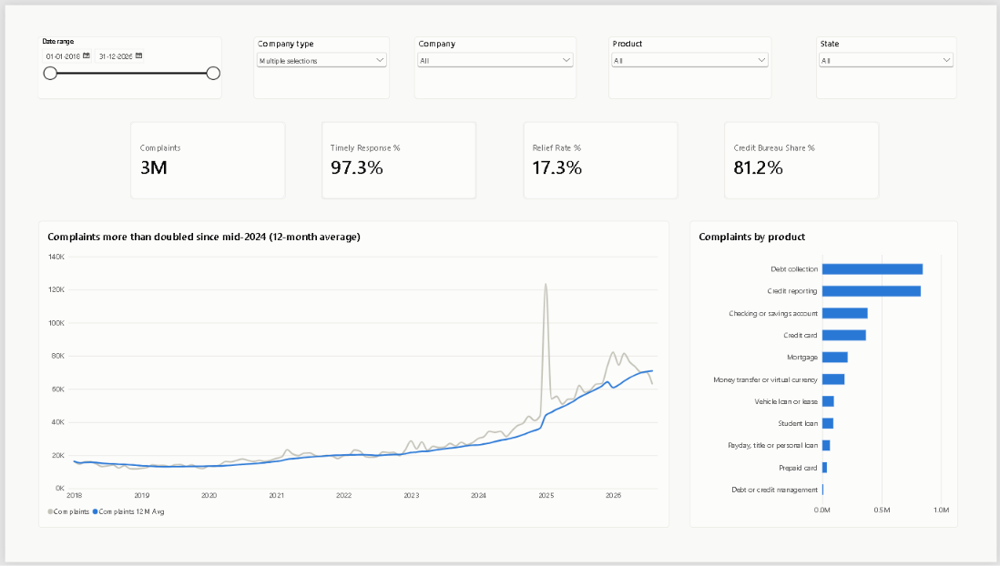
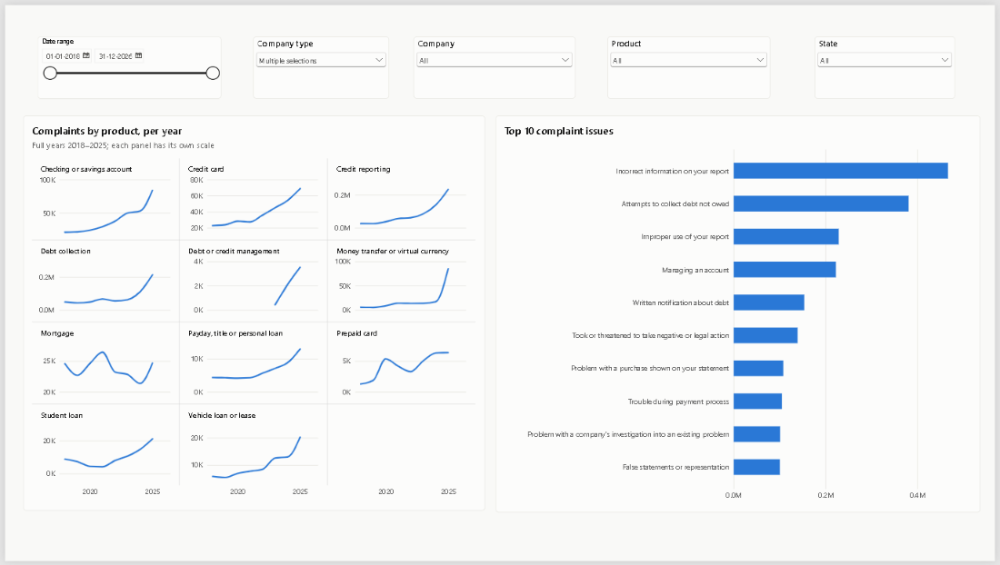
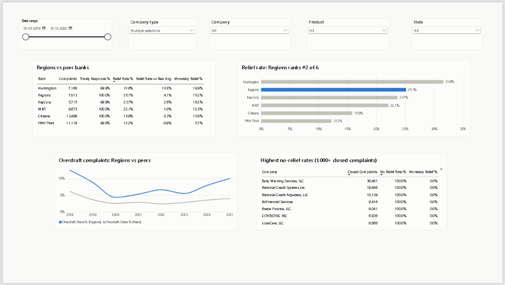
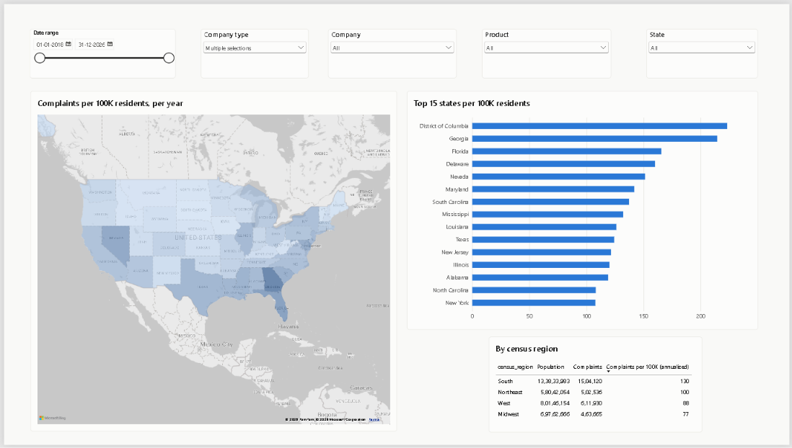
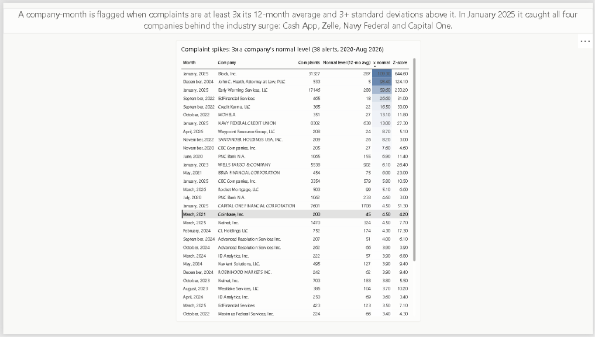

# Consumer Financial Complaints Analysis

An end-to-end analytics project on the **CFPB Consumer Complaint Database**: 17.9M complaints about U.S. banks and financial companies, taken from raw download to a tested star-schema database, SQL analysis, an interactive Power BI dashboard. It includes a peer benchmark of **Regions Bank** against five similar regional banks.

**Stack:** Python (pandas) · SQL (DuckDB) · Power BI + DAX · statistical testing · FDIC & Census APIs · Parquet · Git

> **Status:** complete: data pipeline, SQL analysis, statistical tests, early-warning system and the 5-page Power BI dashboard.

---

## Business questions

1. Which products and sub-products get the most complaints, and how is that trending year over year?
2. Which companies have the worst timely-response rates and the most complaints closed without relief?
3. How are complaints distributed geographically, by state and per capita?
4. How does Regions Bank compare with similar regional banks on volume, top issues and response performance?
5. What are the month-over-month trends, with rolling averages?
6. Can complaint surges be detected automatically, early enough to act on?
7. How does Regions compare once bank size is accounted for, and are the gaps statistically significant?

## Key findings

Analysis window: Jan 2018 – Aug 2026, 16,586,389 complaints. Details and the query behind every number: [docs/analysis_findings.md](docs/analysis_findings.md).

**1. Overdraft complaints at Regions are 2.5x the peer rate and rising again**: 10.1% of Regions' 2025 complaints vs. 4.0% for peers (p < 0.001), up from 5.5% in 2023, despite the CFPB's $191M overdraft order in 2022. **Adjusted for bank size, the gap is 2.7x**: 0.85 overdraft complaints per $1B of deposits vs. 0.32 for peers.





**2. Regions handles complaints well, and its overall complaint burden is average**: it ranks #2 of 6 on relief rate (25.1% vs. a 21.1% peer average; statistically significant against the pooled peers, though not against KeyCorp alone) and responds on time to 99.96% of complaints. Per $1B of deposits, its overall complaint volume (8.43 in 2025) is in line with peers (rate ratio 1.06, not significant).



**3. Complaints about banks and lenders more than doubled since mid-2024**: excluding the three credit bureaus, the 12-month average rose from 30K to 71K complaints per month. A one-month spike in Jan 2025 peaked the day after the CFPB's $175M order against Cash App.



**Also:**
- Credit reporting is **84.8%** of all complaints and grew **43x** from 2018 to 2025. The three credit bureaus alone account for **81.2%** of complaints, so bank-focused views exclude them.
- Relief is rare: among 295 non-bureau companies with 1,000+ closed complaints, the **median company gives relief on 1.0%**, and **71 gave none**.
- The **South has the most complaints per resident** (2,358 per 100K in 2025), and **Georgia ranks #1**.

Stakeholder summary with recommendations: [docs/stakeholder_brief.md](docs/stakeholder_brief.md)

## Dashboard

Five interactive Power BI pages (Executive Overview, Product & Issue Trends, Company Benchmarking, Geographic View, Early Warning) with synced filters for date range, company type, company, product and state. File: [dashboard/cfpb_complaints.pbix](dashboard/cfpb_complaints.pbix); build guide: [dashboard/POWERBI_GUIDE.md](dashboard/POWERBI_GUIDE.md).

**Executive Overview:** KPIs, the monthly trend with a 12-month average, and complaints by product



**Product & Issue Trends:** yearly trend per product (small multiples) and the top 10 issues



**Company Benchmarking:** Regions vs. peers on relief and overdraft, and the companies that most often close complaints without relief



**Geographic View:** complaints per 100K residents by state and census region



**Early Warning:** every company-month flagged by the early-warning rule, largest spikes first



*Screenshots show the default view, which excludes the three credit bureaus. A live link isn't available because Power BI's Publish to web requires a work or school account; open the `.pbix` in Power BI Desktop (free) to explore it.*

**29 DAX measures** ([dashboard/measures.dax](dashboard/measures.dax)) cover timely-response %, relief rate, YoY and MoM change, 3- and 12-month rolling averages, annualized complaints per 100K residents, and peer-average benchmarks. The build guide checks the measures against the SQL results page by page.

## Early-warning system

An automated monitor ([sql/analysis/17_early_warning.sql](sql/analysis/17_early_warning.sql)) flags any company-month where complaints jump to at least **3x the company's own 12-month norm** and at least 3 standard deviations above it. It fires **38 times in the 80 months from 2020 to Aug 2026 (about one alert every two months)**, a realistic workload for a monitoring team. Back-tested on January 2025, it flags all four companies behind that month's surge, Block/Cash App (109x normal), Early Warning/Zelle (60x), Navy Federal (13x) and Capital One (4.5x), plus one other (CBC Companies).

Statistical tests for every Regions-vs-peer comparison (two-proportion z-tests, Wilson confidence intervals, Holm correction) are in [notebooks/08_significance_tests.py](notebooks/08_significance_tests.py).

## How it works

```
CFPB CSV (5.4 GB) ─► DuckDB raw table ─► typed & cleaned staging ─► star schema ─► 10 data-quality tests
                                                                         │
                          ┌──────────────────────────────────────────────┼────────────────────────┐
                          ▼                                              ▼                        ▼
               SQL analysis (22 queries)               Parquet export (2.4M-row monthly     Statistical tests
               → results/*.csv                         aggregate) → Power BI dashboard      (significance, size-adjusted)
```

**Star schema:** `fact_complaints` (one row per complaint) joined to `dim_company`, `dim_product`, `dim_issue`, `dim_geography` (with Census 2025 population) and `dim_date`.

**Main design decisions** (full log: [docs/data_cleaning.md](docs/data_cleaning.md)):
- **DuckDB**: a columnar engine suited to large scans and aggregations. It installs with `pip`, and the SQL carries over to Postgres or Snowflake.
- **Raw data loaded as text**, then converted to proper types in a documented cleaning step, so nothing gets silently corrupted (e.g. ZIP codes losing leading zeros).
- **Flags instead of deletions**: bureaus, the analysis window and territories are flagged, so every choice is reversible.
- **A consistent relief outcome** across the CFPB's 2017 change to response categories, which made "closed without relief" answerable across all years.
- **Size adjustment with FDIC deposits**, plus rates, mix and growth indexes, since banks differ in size; differences are tested for **statistical significance**.
- **Validation tests** run before every export; one caught a join that was silently dropping records.

## Reproduce it

Requires Python 3.10+ and about 20 GB of free disk space.

```bash
python -m venv .venv
.venv\Scripts\activate            # Windows  (macOS/Linux: source .venv/bin/activate)
pip install -r requirements.txt

python data/download_data.py      # complaints CSV (330 MB zipped)
python data/build_reference.py    # Census population (already committed)
python data/build_bank_financials.py  # FDIC deposits for the peer banks (already committed)
python run_pipeline.py            # load, clean, model, test, export for Power BI
python notebooks/03_run_analysis.py   # all SQL analysis -> results/
python notebooks/08_significance_tests.py  # statistical tests -> results/q9_significance_tests.csv
python notebooks/07_readme_charts.py  # README charts -> images/
```

Then open `dashboard/cfpb_complaints.pbix` in Power BI Desktop and refresh.

## Repository structure

```
data/         download scripts, Census and FDIC reference data (raw data is gitignored)
sql/          00-04 pipeline (load, clean, schema, tests, export); analysis/ business-question queries
notebooks/    profiling, analysis runner, significance tests, chart rendering
dashboard/    Power BI report, DAX measures, theme, build guide
results/      CSV output of every analysis query
docs/         cleaning decisions, findings, stakeholder brief
images/       charts and dashboard screenshots
```

## Data notes

- Source: [CFPB Consumer Complaint Database](https://www.consumerfinance.gov/data-research/consumer-complaints/), snapshot downloaded 2026-09-22; bank deposits from the [FDIC BankFind API](https://api.fdic.gov/banks/) (year-end Call Reports); population from the U.S. Census Bureau.
- Complaints are **unverified consumer submissions**. They show where customers report problems, not confirmed misconduct.
- Complaint volume partly reflects a company's customer base, so cross-company comparisons use rates and mix.
